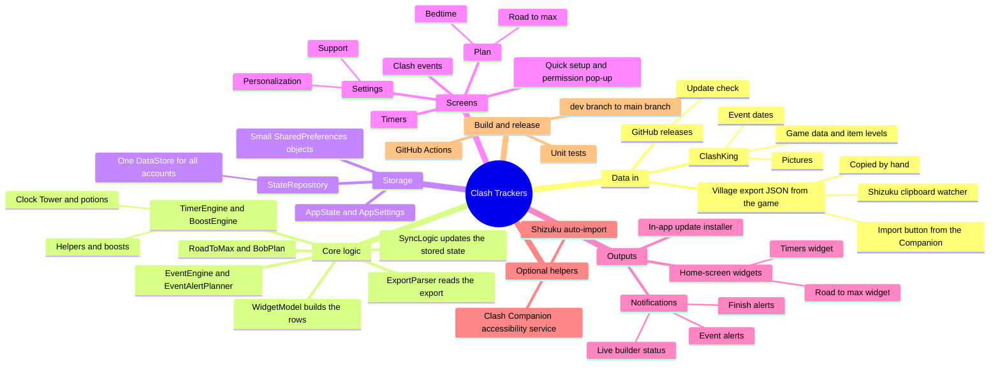

# Contributing

Thanks for helping out. Bug reports, new game IDs and small fixes are all welcome.

- **Bugs:** use the [bug report template](https://github.com/Killersparrow1/clash-Trackers/issues/new/choose) and include the crash report from the app if there is one.
- **Larger changes:** open an issue first, so we can agree on the approach before you spend time on it.
- **Tests:** run `./gradlew :app:testDebugUnitTest` before opening a pull request, and add tests for changes to the parser, the timer engine, event alerts or the Companion's decision logic.

A few rules keep the project working:

- **Never commit a real village export.** It contains your player tag. Test data goes in `app/src/test/resources/fixtures`, with the tag replaced by `#TEST000`.
- **Test with the dev build.** Every build that is not on `main` is `com.killersparrow1.clashtrackers.dev` ("Clash Trackers Dev") and installs next to the real app. Do not hard-code the package name: use `context.packageName`, `${applicationId}` in the manifest, or the `app_package` string (see `res/xml/shortcuts.xml`).
- **Keep R8 off.** Code shrinking caused a start-up crash on Android 10 that the build checks didn't catch.
- **Widget layouts** can only use classes that RemoteViews allows. Anything else, even a plain `View`, stops the whole widget from loading.
- **The accessibility service stays minimal.** Clash Companion (`companion/`) may only listen for window-state changes (`companion_accessibility.xml`: no content retrieval, no gestures). Never read, store or send what is on screen, and keep it event driven: no polling, no wake locks. Its overlay is a `TYPE_ACCESSIBILITY_OVERLAY` window, so the app needs no "draw over other apps" permission. Put decisions in plain Kotlin (`CompanionLogic`, `CompanionSession`) and unit test them.
- **Audio and other raw files.** Sounds live in `app/src/main/res/raw/` (lowercase letters, digits and underscores). A sound looked up by name at run time (the title easter egg) must also be listed in `clashtimer_keep.xml`. A notification channel's sound is fixed once created, so a changed sound file needs a new channel id (`events_v4`, `finished_v4`, `clocktower_v2` ...): bump the id in `notify/` and add the old one to the list of channels the app deletes. Check a sound with **Developer options** (tap the Settings tab 11 times): it can send a test notification on every channel and play each file. Keep a little headroom (peaks around -1.5 dB) so it does not distort.
- **Game data converters stay identical.** `tools/gen_max_data_ck.cjs` and `core/ClashKingData.kt` must produce the same `max_data.json`; change both, regenerate `app/src/main/assets/max_data.json` with the script and check that unrelated items did not change. A step is `[seconds, cost, resource, townHall]`; hero equipment adds the glowy and starry ore as two more numbers.
- **Road to max rules.** The groups and the percentages are described in the README ("How Road to max is calculated"); change that text with the code. Buildings, defences, crafted defenses, traps and pets are weighted by upgrade time; heroes, troops, spells, siege machines and equipment by levels. An upgrade in progress is not done. Siege machines are told apart from troops by a list of ids in `RoadToMaxCalc`, so add new ones there. Put the logic in `core/RoadToMax.kt` and cover it in `RoadToMaxTest`; compare any change with a real village in ClashKing, using a copy of the export that never goes into the repository.
- **Pictures.** Items need a picture under `app/src/main/assets/icons/<id>.webp` (about 128 px) or the app only shows them after the pictures are downloaded. Crafted Defense modules and hero equipment are bundled.
- **Upload to `dev`, not `main`.** Pull requests and GitHub web uploads go to `dev`; `main` only receives merges from it.
- **Network use stays small and visible.** The app uses the internet only for GitHub updates and ClashKing data (game data, pictures, event dates). Never send the player tag, village data or anything personal, and keep a cached copy so the app still works offline.

## Project map

A one-page picture of how the app is put together. Everything below is explained in the sections that follow.

## How the app works

The whole app is one loop: **get a village export, turn it into timers, show the timers, and wake up when one ends.**

1. **Get the export.** The game's *Settings > Data Export > Copy* puts a JSON text on the clipboard. It reaches the app in one of three ways: you paste or tap Sync (`sync/SyncRunner.kt`), the Companion's floating button (`companion/`), or the optional Shizuku watcher (`shizuku/`, `sync/ClipboardAutoSync.kt`). All three end in `SyncRunner.sync`, so there is one import path.
2. **Parse it.** `core/ExportParser.kt` checks that the text is really a village export and fills a `VillageExport` (`core/Model.kt`): Town Hall, builders, running upgrades (jobs), levels you own, boosts, helpers.
3. **Update the stored state.** `core/SyncLogic.kt` merges the new export into the account's `AppState` (`core/AppState.kt`), applies boosts and the Clock Tower window, and keeps your own settings. `data/StateRepository.kt` saves it. Each player tag is its own account.
4. **Build rows.** `core/WidgetModel.kt` turns the state into rows: running, completed or idle, with a remaining time, a progress value and a picture id. `ui/TimerDashboardModel.kt` sorts and filters them for the Timers screen. The widget, the notifications and the alarms all read the same rows, so they agree with each other.
5. **Show them.** Screens are Jetpack Compose (`ui/`). Widgets are plain `RemoteViews` (`widget/`), because widgets cannot use Compose.
6. **Wake up.** When something finishes, an exact alarm (`WidgetAlarm`, `notify/`) redraws the widgets and posts the finish notification. After a reboot or an update the alarms are set again.

**Pictures.** `widget/WidgetRenderer.kt` (`WidgetIcons`) finds a picture by item id and level. It looks in the downloaded copies first, then in `assets/icons`. Buildings and traps have one picture per level, fetched on demand by `update/RemoteIcons.kt`.

**Game data.** `assets/max_data.json` (what each level costs, how long it takes, which Town Hall allows it) and `assets/names.json` (names) are generated from ClashKing's data by the scripts in `tools/`. `data/MaxDataStore.kt` can swap in a newer downloaded copy.

## Where things live

All paths are under `app/src/main/java/com/killersparrow1/clashtrackers/` unless stated.

| Folder | What is in it |
|---|---|
| `core/` | The logic that decides things. No Android screens. Most of it is plain Kotlin that unit tests can run: `ExportParser`, `SyncLogic`, `TimerEngine`, `BoostEngine`, `WidgetModel`, `RoadToMax`, `BobPlan`, `EventEngine`, `Countdown`, `GameIds`. |
| `data/` | Saving and loading: `StateRepository` (DataStore), `MaxDataStore` (game data), `WidgetTexts` (localised text for the rows). |
| `sync/` | Getting an export in (`SyncRunner`, `SyncActivity`, `ClipboardAutoSync`) and small stored choices (`GoldPassStore`, `SleepStore`, `IdleAlert`, `ClockTowerTracking`, `AppIcon`). |
| `ui/` | Compose screens and dialogs. `ClashTrackersContent.kt` is the shell: the four bottom tabs and their swipeable pages. |
| `widget/` | The home-screen widgets (`ClashWidget`, `RoadWidget`), their list service and the renderer that fills the layouts. |
| `notify/` | Notifications and alarms: `Notifier` (finish alerts), `EventAlerts`, `LiveStatus`, their receivers. |
| `update/` | Everything that touches the network: app updates, game data, event dates, pictures. |
| `companion/` | The accessibility service (the floating import button). Decisions are in `CompanionLogic` and `CompanionSession`. |
| `shizuku/` | The optional clipboard watcher that runs in the Shizuku service process. |
| `crash/`, `locale/` | The crash catcher and the language switch. |
| `app/src/main/res/` | Strings (`values/`, `values-ru/`, `values-hi/`), layouts for the widgets, drawables, fonts, sounds (`raw/`), `xml/` (widget info, shortcuts, accessibility, locales). |
| `app/src/main/assets/` | `max_data.json`, `names.json`, `upgrade_times.json`, `icon_paths.json`, `icons/`. |
| `app/src/test/` | Unit tests. Fixtures (anonymised exports) are in `resources/fixtures`. |
| `tools/` | Node scripts that regenerate the game data files from ClashKing. |
| `.github/workflows/` | The Build APK workflow. |

The four bottom tabs are Timers, Plan (Road to max, Bedtime), Clash (events) and Settings (Settings, Personalization, Support). Do not add a fifth.

## Recipes

**Add a setting.** Put the text in `res/values/strings.xml`. Add the control to the right card in `ui/SettingsSection.kt` (`SectionCard`, `SwitchRow`, `CheckRow`). If a widget or the timer logic needs the value, add a field with a default to `AppSettings` in `core/AppState.kt` and change it through `onChange { it.copy(...) }`. If only a screen or a notification needs it, use a small object over `SharedPreferences` like `ui/AccessibilityReminder.kt` and, if the screen has to redraw when it changes, hold the value in a Compose state.

**Add a screen or a page.** Add the composable in `ui/`. For a new page inside an existing tab, add an entry to the `Page` enum in `ClashTrackersContent.kt` and show it in the `when` that draws the pages. Strings go in `values/strings.xml`.

**Add a new item (a new building, troop, spell and so on).** Regenerate the data with the scripts in `tools/` (see "Game data converters stay identical" above), check that unrelated items did not change, and add the picture at `assets/icons/<id>.webp` if it is not downloaded. Special rules that need the raw id (for example siege machines in `RoadToMaxCalc`, or `GameIds`) are edited by hand.

**Change how a timer is calculated.** Look in `core/TimerEngine.kt` (helpers and sessions), `core/BoostEngine.kt` and `core/SyncLogic.kt` (boosts, potions, Clock Tower window) and `core/WidgetModel.kt` (rows). Add or update a test in the matching `*Test.kt` before you touch the logic, and use a copy of a real export from `app/src/test/resources/fixtures` to check it.

**Add a row or a label to the timer list.** Rows are made in `core/WidgetModel.kt`. Put the user-facing text in `core/WidgetText.kt` and fill it in `data/WidgetTexts.kt` from a string resource. The screen reads rows through `ui/TimerDashboardModel.kt`; a widget draws them in `widget/WidgetRenderer.kt` with the `widget_row*.xml` layouts.

**Add a notification.** Create the channel in `notify/` with a new id (a channel's sound and importance cannot be changed once it exists), schedule it with an exact alarm and make a receiver that also re-plans after a reboot, an app update and a time change. Look at `EventAlerts.kt` and `EventAlertReceiver.kt` as the model. Register the receiver in `AndroidManifest.xml`; `ManifestClassesTest` checks that the classes named there exist.

**Add a new Compose style or motion.** Colours and type are in `ui/theme/`. Shared touch effects and the card animations are in `ui/UiComponents.kt` and `ui/Motion.kt`; reuse them instead of writing a new one.

**Add or change a string.** English goes in `values/strings.xml`. A language you leave out falls back to English. If you do translate it, keep the placeholders (`StringsConsistencyTest` checks).

## Build, run and test

- **Needs:** Android SDK (Platform 37, Build-Tools 36) and JDK 21 or newer. CI uses a newer JDK; Node 22 is only for the scripts in `tools/`.
- **Run the unit tests:** `./gradlew :app:testDebugUnitTest`. Run them before every upload; the CI build runs them first and stops if one fails.
- **Build a phone app:** `./gradlew assembleDebug -PdevBuild=true` builds "Clash Trackers Dev", which installs next to the real app. Without `-PdevBuild=true` the package is the real one.
- **Cloud build:** *Actions > Build APK > Run workflow* on the branch, then download `ClashTrackers-debug-apk` from the run.
- **Look at your change on a phone.** The unit tests only check logic. Screens, widgets, notifications and permissions can only be checked by installing the app.

## Branches and releases

- All work goes to `dev`. `main` only receives merges from `dev`.
- A push to `main` runs the workflow: unit tests, a debug build, a release build, and then the release job (after the production approval) publishes a GitHub release. The in-app updater reads the latest release and installs its APK.
- Releases are numbered `CT<major>.<minor>`; the workflow picks the next number itself.
- Keep `CHANGELOG.md` up to date for anything a player can notice.

## Keeping things safe

- Do not change the signing key unless you plan for every user to uninstall once: Android refuses an update signed with another key.
- Do not commit passwords, keystores or real village exports.
- Keep the accessibility service as small as it is now (see the rules above) and keep it optional. Nothing in the app should need it to work.

## Adding a language

The app is translated through normal Android string resources, so the core of a language takes three small steps and no Kotlin code. A full translation adds one optional JSON file.

1. **Copy the English file.** Create `app/src/main/res/values-xx/strings.xml`, where `xx` is the language code (`ru` for Russian, `es` for Spanish, `pt-rBR` for Brazilian Portuguese; see the [Android resource qualifiers](https://developer.android.com/guide/topics/resources/providing-resources#AlternativeResources)). Start from `app/src/main/res/values/strings.xml` and translate the text between the tags. This file covers the UI **and** the widget: countdown units (`1д 20:12:05`), footer labels ("Completed", "Helpers: …"), and the Support diagnostics all come out of it.
2. **Keep the placeholders.** Text like `%1$s`, `%1$d` and `%%` is filled in by the app. Keep every placeholder from the English text; you may reorder them (`%2$d ... %1$s`). Use `\'` for an apostrophe and `&amp;` for `&`. Leave `app_name` and `widget_name` out unless you really want to change them.
3. **Register the language.** Add one line to `app/src/main/res/xml/locales_config.xml`: `<locale android:name="xx" />`. This is what makes the language appear in **Settings > Language** (shown by its own name, for example "Русский") and in Android's own *App languages* screen.
4. **(Optional) Translate the game names.** The 250 upgrade, building, troop, pet, spell, equipment and trap names live in `app/src/main/assets/names.json` (English). Copy it to `names_xx.json` inside the same `assets/` folder and translate each `"name"` value — the numeric keys are the game's internal IDs and must stay untouched. Then add one line to the `LOCALIZED_FILES` map in `StateRepository.Names` (about 20 lines up in `app/src/main/java/com/killersparrow1/clashtrackers/data/StateRepository.kt`), for example `"es" to "names_es.json"`. If you skip this step, names fall back to English.

In Russian, a crafted-defense stat reads like `Урон · Тортопульта` (stat first, building second) because `widget_module_label` reorders the two placeholders — reorder other phrases the same way if your language needs it.

Strings you leave out fall back to English, so a partial translation is fine. `./gradlew :app:testDebugUnitTest` includes `StringsConsistencyTest`, which fails if a translation uses an unknown name, changes the placeholders, or is missing from `locales_config.xml`.

Translations written with AI help should say so in a comment at the top of the file, as `values-ru/strings.xml` and `names_ru.json` do, so native speakers know to review them. The Russian game-name draft uses community-checked terms (Ратуша, Швырятель, Потайная тесла), but specialists are still welcome to fix official wording.

Your contributions are licensed under the MIT License, the same as the project's code.
