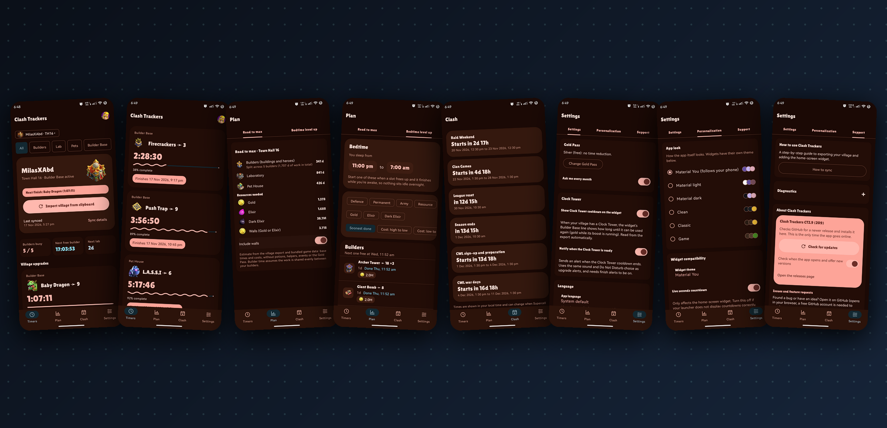
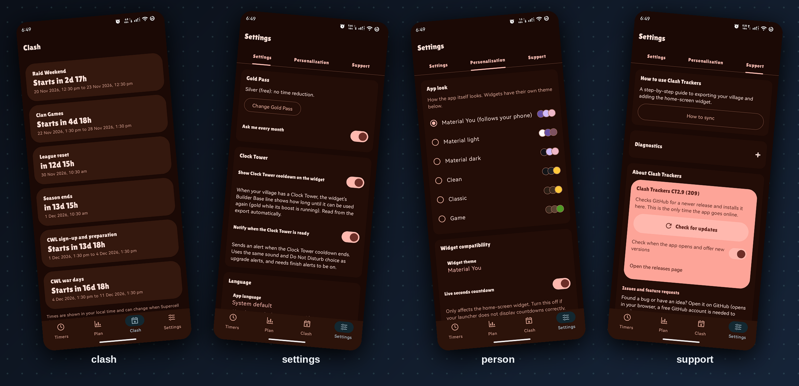
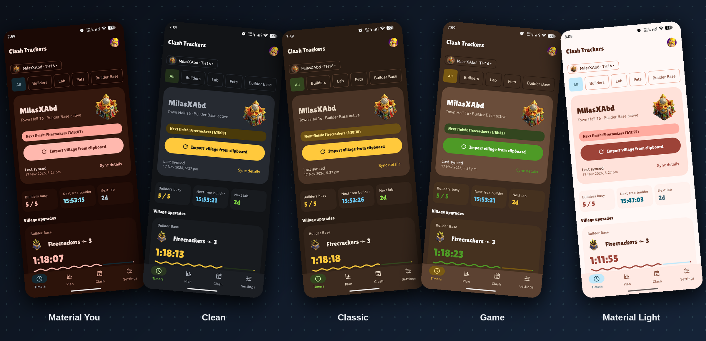
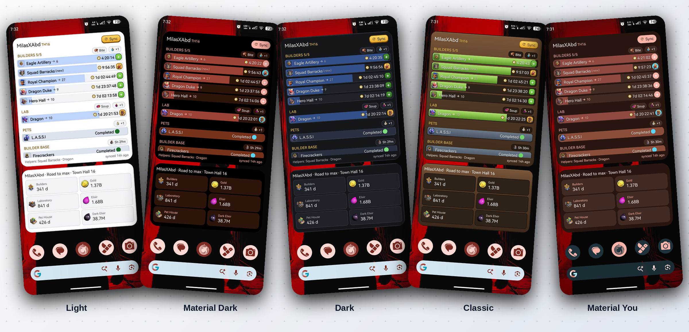
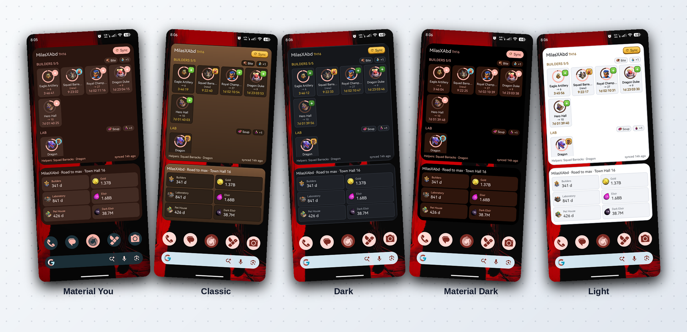

<p align="center">
  
</p>

<h1 align="center">Clash Trackers</h1>

<div align="center">


[](LICENSE)

</div>

A modern Android app and home-screen widgets for **Clash of Clans** that track your Home Village and Builder Base upgrade timers, potions and game events in real time, and plan what to upgrade next.

Built with **Material 3 Expressive**, the Clash typeface, a deterministic boost engine and full Builder Base support. The app works online: game data, pictures and event dates come from [ClashKing](https://clashk.ing), and everything it downloads is cached on the phone, so the last good copy stays available when the connection drops.

> **Unofficial fan project.** Not affiliated with, endorsed, sponsored or approved by Supercell. See the [Disclaimer](#disclaimer).

<p align="center">
  <a href="https://apps.obtainium.imranr.dev/redirect?r=obtainium://app/%7B%22id%22%3A%22com.killersparrow1.clashtrackers%22%2C%22url%22%3A%22https%3A%2F%2Fgithub.com%2FKillersparrow1%2Fclash-trackers%22%2C%22author%22%3A%22Killersparrow1%22%2C%22name%22%3A%22Clash%20Trackers%22%7D"></a>
</p>

---

## Screenshots
<p align="center">
  
  
</p>

---
## Looks
<p align="center">
  
</p>

---

## Widget Themes
### List Widget
<p align="center">
  
</p>

---

### Grid Widget
<p align="center">
  
</p>

## Highlights

### Timers
- **One dashboard** for builders, the event Goblin Builder, the Laboratory, the Pet House and the Builder Base (Night Village builders and Star Laboratory), with expressive cards, category chips and wavy progress bars.
- **Finish time on every card**, calculated from the same finish time as the countdown (boosts, potions and helpers included).
- **Stat tiles and totals**: builders busy, next free builder, next lab, and the total builder and lab time left.
- **Sync on open**: copy your village in Clash of Clans (**Settings > Data Export > Copy**) and open the app. Only a real village export is used, and each export once.
- **Multiple accounts**: every export carries a player tag, so each tag becomes its own account with a switcher, rename and delete. Different widgets can show different accounts.
- **Gold Pass** (set once a month) for the things the export cannot tell, such as a job's full length for its progress bar.
- **Open game** button and launcher shortcuts for Sync and Open game.

### Boosts and potions
- Home Village Builder Potion, Builder Bites, Study Soup, Research and Pet potions with the game's stacking rules, read straight from the export.
- Builder Base Clock Tower and Clock Tower Potion, detected from the export, with a ready chip on the widget and an optional ready alert.
- Hammer Jam and Builder Base Bonanza reductions are already in the exported times.
- A time-segment simulation handles boost start, expiry and overlap without drift; state survives reboots.

### Plan tab
- **Road to max**: time and Gold / Elixir / Dark Elixir still needed to max your Town Hall (buildings, defences, traps, heroes, lab, pets and an optional walls total). An estimate from your export plus ClashKing's game data; potions, helpers, events and the Gold Pass are not counted.
- **Bedtime level up**: set when you sleep and it lists what to start in each free builder, lab or pet slot so upgrades run through the night and finish after you wake.
- A **Road to max widget** shows the same numbers on the home screen.

### Clash tab
- **Live event schedule** with countdowns in your local time: raid weekend, season end, Clan Games, Clan War League signup and wars, league reset.
- **Sources**: raid weekend and season end come from the [ClashKing API](https://api.clashk.ing/swagger/index.html). Everything else (ClashKing has no endpoint for it) is worked out from the game's usual UTC schedule, and `events.json` in this repository can override any event.
- **Always instant**: the last good schedule is stored on the phone and shown the moment the tab opens. It refreshes in the background about every 6 hours, or on demand with the refresh button, and shows when it last synced. A failed refresh never throws the cache away.

### Game data (Settings)
- Costs, times, levels, names (English and Russian) and per-Town-Hall counts come from ClashKing's [ClashKingAssets](https://github.com/ClashKingInc/ClashKingAssets) (`static_data.json`), so new Town Halls and items arrive without an app update.
- **Check for new data** (or the automatic option) downloads from `assets.clashk.ing`, with the GitHub copy as a backup, converts the file on the phone, validates it and only then swaps it in atomically. A failed or invalid update leaves the data in use untouched. **Use the built-in data** goes back to what shipped with the app.
- Pictures are downloaded from `assets.clashk.ing` into the phone's storage and used in place of the built-in ones; the weekly refresh picks up new items.
- A weekly GitHub Action regenerates the bundled files from ClashKing and opens a pull request only when something changed (see [Game data pipeline](#game-data-pipeline)).

### Widgets
- **Three styles** per widget: **List** (a progress bar per timer), **Grid** (progress rings with the building icon) and **Minimal** (black, dot-matrix, one red accent).
- **Five themes**: Material You, Classic, Dark, Material dark and Light, set as a default in Settings and overridable per widget (Minimal keeps its own look).
- Live per-second countdowns, scrolling at any size, goblin badges, helper assignment (Builder's Apprentice and Lab Assistant) with predicted finish times, and exact alarms for re-rendering at completion edges.
- A picker asks which account each widget should show.

### Interface
- **Four tabs**: Timers, Plan, Clash and Settings (sub-tabs: Plan has Road to max and Bedtime level up; Clash has Events; Settings has Settings, Personalization and Support), with swipe to switch.
- **Six app looks** in **Settings > Personalization > App look**: Material You (follows your phone), Material light and Material dark (always light or always dark, whatever the phone is set to), and the fixed Clean, Classic and Game palettes. Widgets have their own theme.
- Material You colour on Android 12+, a themed launcher icon on Android 13+, a navigation rail on tablets and a two-column Timers screen on wide displays.
- A subtle wiggle and light haptic feedback when you press cards.
- Lilita One for headings and numbers; filter chips that get out of the way as you scroll.
- **Languages**: English and Russian, chosen in **Settings > Language**. New text is added in English first. See [Adding a language](CONTRIBUTING.md#adding-a-language).

### Notifications
- Finish alerts when a builder, the lab or a pet is free, with the Clash of Clans sound; a Clock Tower ready alert; an optional idle reminder (off by default).
- A switch makes alerts follow Do Not Disturb (default) or ring through it like an alarm.

### Updates, support and diagnostics
- **Update notification**: a background check (about every 12 hours, online only) posts one notification when a new release is out, even if the app is closed. Turn it off with the update switch in **Settings > Support > About**.
- **In-app update**: **Settings > Support > About > Check for updates** looks up the latest GitHub release, shows what is new, downloads the APK and hands it to Android's installer. Builds use a fixed signing key, so updates install over the old version. [Obtainium](https://github.com/ImranR98/Obtainium) also works: add `https://github.com/Killersparrow1/clash-Trackers`.
- **Issues and feature requests** open [GitHub Issues](https://github.com/Killersparrow1/clash-Trackers/issues/); *Report an issue* copies a diagnostic report first.
- **Diagnostics**: a health checklist (saved village, notifications, exact alarms, battery restriction, icons) and a copyable report with app, Android and widget info, recent activity and the last crash. It never includes your player tag or name.
- A short toast on launch asks you to connect when there is no internet.

### Privacy
- No account, no ads, no tracking. Your village data stays on the phone.
- The internet is used for: the update check and APK download from GitHub, game data and pictures from `assets.clashk.ing` (and its GitHub copy), and event dates from `api.clashk.ing`. None of these requests carry your village, player tag or name.
- The clipboard is read when you tap **Sync** or open the app, and only a Clash of Clans village export is used.

---

## Quick setup

1. **Get the APK** from the latest [release](https://github.com/Killersparrow1/clash-Trackers/releases/latest), through Obtainium, or build it with GitHub Actions.
2. **Open Clash of Clans**: **Settings > Data Export > Copy**.
3. **Open Clash Trackers**: the village syncs automatically (or tap **Import village from clipboard**).
4. **Add a widget**: long-press the home screen, choose **Widgets > Clash Trackers**, pick the account, style and theme.
5. **More accounts**: switch account in Clash of Clans, copy its export and open the app again.
6. **Notifications**: turn on finish alerts in **Settings > Notifications**.

---

## How the data flows

| What | Source | Stored | Fallback |
|---|---|---|---|
| Costs, times, levels, counts | ClashKing `static_data.json` | `max_data_downloaded.json` (replaced only after validation) | Data bundled in the app |
| Names (EN, RU) and upgrade times | Bundled, regenerated from ClashKing | App assets | n/a |
| Pictures | `assets.clashk.ing` | `remote_icons/` in app storage | Built-in icons |
| Raid weekend, season end | `api.clashk.ing/v2/dates` | `clashking_dates.json` | Built-in schedule |
| Clan Games, CWL, league reset | Built-in schedule (UTC) | n/a | `events.json` overrides |
| Your village and timers | Clash of Clans export | App storage (DataStore) | n/a |

Raid weekend and season end use the API only while the cached answer is fresh (under 14 days old) and sane; otherwise the built-in schedule takes over.

---

## Architecture

```
clash-trackers/
├── app/src/main/java/com/killersparrow1/clashtrackers/
│   ├── core/      # Pure Kotlin: parser, boost and timer engines, plan logic, events
│   │   ├── ClashKingData.kt    # ClashKing static_data.json -> the app's game data format
│   │   ├── ClashKingDates.kt   # /v2/dates parsing and the cached dates model
│   │   ├── GameEvents.kt       # Event schedule (API dates first, algorithm as fallback)
│   │   ├── RoadToMax.kt, Bedtime.kt, TimerEngine.kt, BoostEngine.kt, ExportParser.kt ...
│   ├── data/      # DataStore state, game data store (validated, atomic install)
│   ├── update/    # DataUpdater, ClashKingDatesStore, RemoteIcons, EventsStore, AppUpdater, Connectivity
│   ├── ui/        # Compose Material 3 Expressive screens (Timers, Plan, Clash, Settings, About)
│   ├── widget/    # RemoteViews widgets, renderers, account picker
│   ├── notify/ sync/ locale/ crash/
├── app/src/test/  # Unit tests (parser, engines, game data conversion, dates, localisation)
├── tools/         # Node generators that build the bundled game data from ClashKing
└── .github/workflows/  # build-apk.yml, update-game-data.yml
```

### Game data pipeline
`tools/gen_*_ck.cjs` convert ClashKingAssets into `max_data.json`, `upgrade_times.json`, `names.json`, `names_ru.json` and `icon_paths.json`. `ClashKingData.kt` does the same conversion on the phone for downloaded updates; keep the two in step. The weekly **Update game data** workflow runs the generators and opens a pull request to `main` only when the output changed, and refuses results with fewer Town Halls or a drop of more than 10% in items.

---

## Building from source

**Cloud build:** push to your fork, open **Actions > Build APK > Run workflow** and download `ClashTrackers-debug-apk`. CI runs the unit tests first.

**Local build:** Android SDK (Platform 37, Build-Tools 36) and JDK 21+.

```sh
git clone https://github.com/Killersparrow1/clash-Trackers.git
cd clash-Trackers
./gradlew :app:testDebugUnitTest
./gradlew assembleDebug
```

---

## Permissions

| Permission | Purpose |
|---|---|
| `INTERNET` | Game data, pictures and event dates from ClashKing, and the update check and download from GitHub. |
| `ACCESS_NETWORK_STATE` | Detects whether the phone is online, for the launch toast. |
| `USE_EXACT_ALARM` / `SCHEDULE_EXACT_ALARM` | Exact alarms to re-render the widget when upgrades finish. |
| `POST_NOTIFICATIONS` | Finish, Clock Tower and idle alerts. |
| `RECEIVE_BOOT_COMPLETED` | Reschedules alarms after a reboot. |
| `REQUEST_INSTALL_PACKAGES` | Hands a downloaded update to Android's installer. |

---

## Credits

- **[ClashKing](https://clashk.ing)**: game data, names, upgrade times and pictures from [ClashKingAssets](https://github.com/ClashKingInc/ClashKingAssets) (GPL-3.0, data only; no code copied), and event dates from the [ClashKing API](https://api.clashk.ing/swagger/index.html). Thank you to the ClashKing team.
- **Original project**: built upon [Kuswaa/clash-timers](https://github.com/Kuswaa/clash-timers); Material 3 UI ideas from [Hy4ri/clash-timers](https://github.com/Hy4ri/clash-timers/tree/feat/material-app-ui).
- **Built-in icons** (shown until the current pictures download) and the Study Soup and Clock Tower level images: [clash-of-clans-data](https://github.com/chiefpansancolt/clash-of-clans-data) by Christopher Pezza (MIT). This is the only thing still taken from that package.
- **Fonts**: [Lilita One](app/src/main/res/font/lilita_one.ttf) by Juan Montoreano and [Doto](https://github.com/oliverlalan/Doto) by The Doto Project Authors, both SIL Open Font License 1.1 (licences in `app/src/main/assets/licenses/`).
- **Finished-upgrade sound**: game audio from Clash of Clans, © Supercell, used under the Fan Content Policy and not covered by the MIT License. Source: [Zedge mirror](https://www.zedge.net/notification-sounds/2e5dc20a-223a-460a-8ab7-14ac75b6c127).

Thank you to everyone on [r/ClashOfClans](https://www.reddit.com/r/ClashOfClans/) who tried the app, reported bugs, shared test exports and suggested features. Contributions are welcome; see [CONTRIBUTING.md](CONTRIBUTING.md).

---

## License

The source code is licensed under the [MIT License](LICENSE). Game assets, names, logos and audio belong to Supercell and are not covered by it; see [NOTICE](NOTICE) for the full list, including the ClashKing data.

## Disclaimer

This material is unofficial and is not endorsed by Supercell. For more information see Supercell's Fan Content Policy: [www.supercell.com/fan-content-policy](https://www.supercell.com/fan-content-policy).

## Releasing (maintainers)

- **Dev builds:** Actions > **Build APK** > **Run workflow** on `dev`, then download the APK. Nothing is published.
- **Production:** merging into `main` runs the same build, then the **release** job waits for approval (Actions > the run > **Review deployments** > `production`). Not approving means no release.
- **After approval** it takes the next version from the newest `CT` tag (`CT2.3` to `CT2.4`, ... `CT2.9` to `CT3.0`), tags the built commit and publishes a GitHub Release with `ClashTrackers-CT2.4.apk` and generated notes.
- **One-time setup:** Settings > **Environments** > New environment `production` > **Required reviewers**, add yourself, before merging. Also enable Settings > Actions > General > **Allow GitHub Actions to create and approve pull requests** for the weekly game data pull request.
- Dev and release builds share one version rule, so installing either over the other always works.
