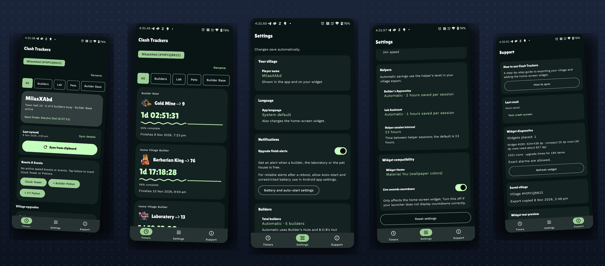
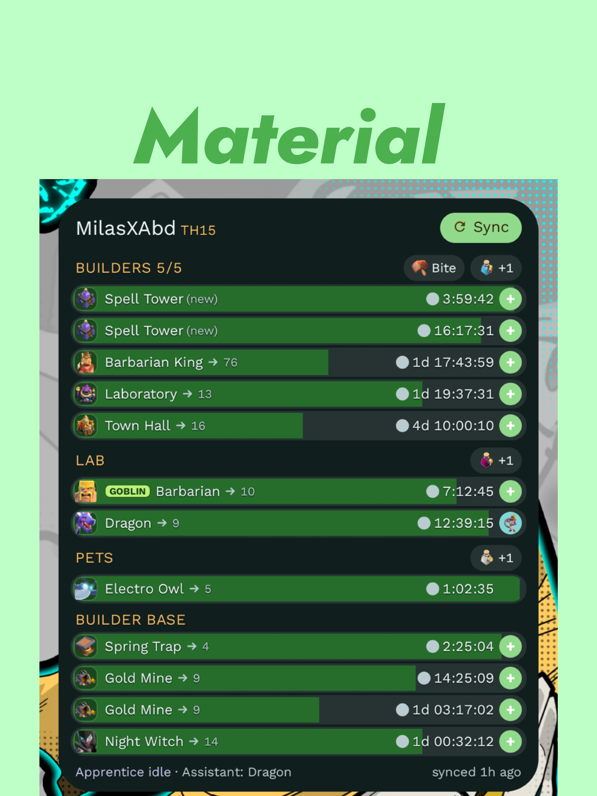
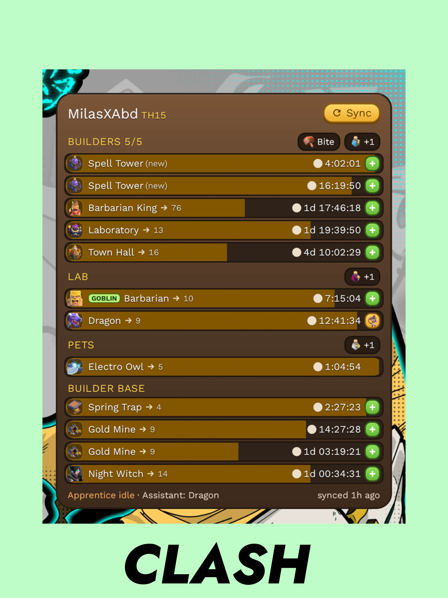
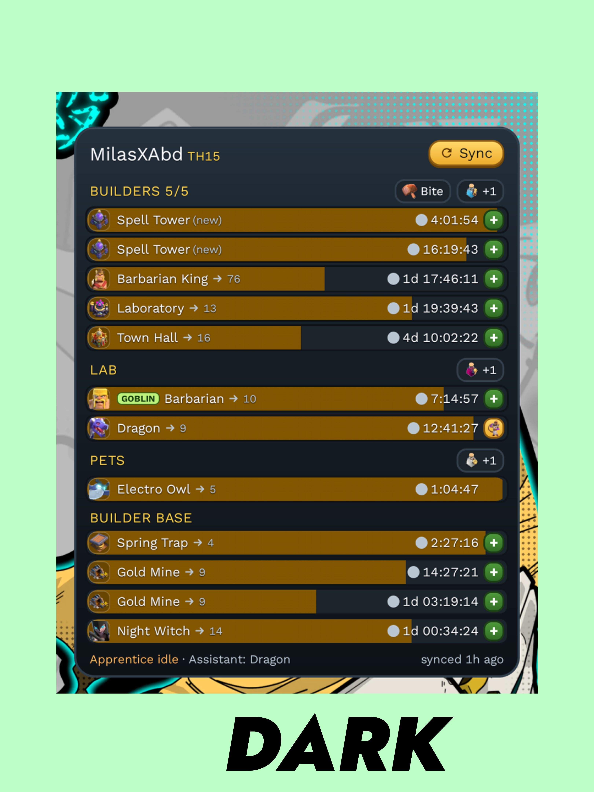
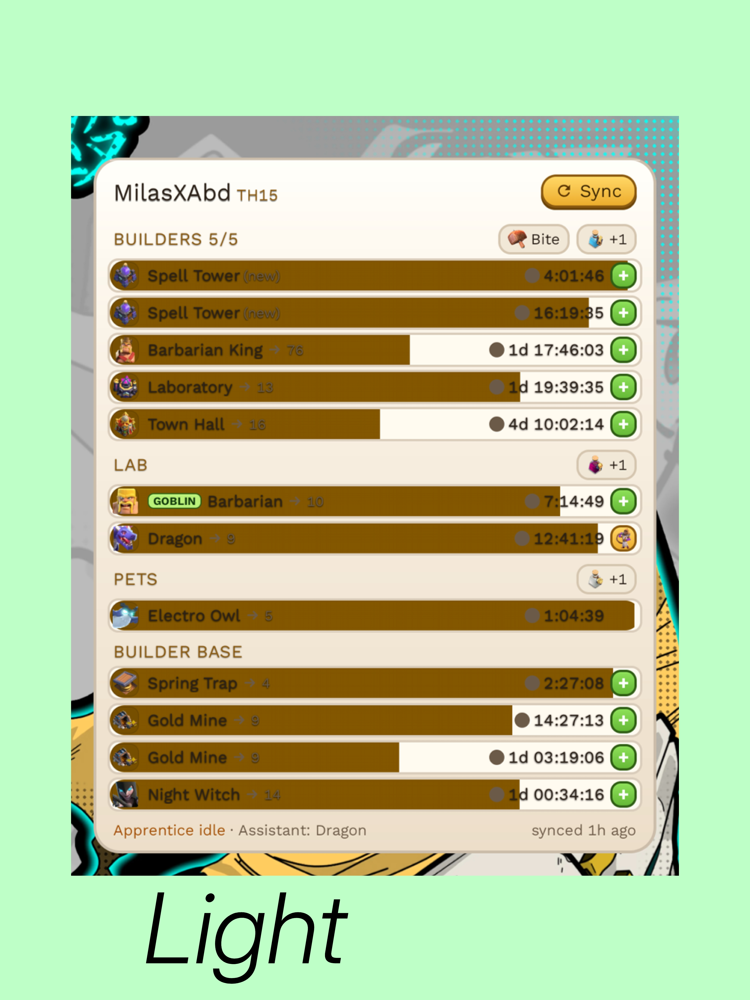

<p align="center">
  
</p>

<h1 align="center">Clash Trackers</h1>

<div align="center">


[](LICENSE)

</div>

A modern, offline Android application and home-screen widget for **Clash of Clans** that tracks your Home Village and Builder Base upgrade countdowns, potions, and special events in real time.

Redesigned with **Material 3 Expressive**, authentic Clash typography, an advanced boost calculation engine, and full Builder Base support.

> **Unofficial Fan Project**: This application is not affiliated with, endorsed, sponsored, or approved by Supercell. See the [Disclaimer](#disclaimer).

---

## Screenshots
<p align="center">
  
</p>

## Widget Themes
Five colour themes, chosen per widget: **Material You** (follows your phone's wallpaper colours), **Clash** (the original wood panel and green bars), **Dark** (neutral dark with a blue bar), **Material pitch dark** (Material You colours on a true black panel) and **Light** (clean white with a pale blue bar). Each theme has its own progress-bar colour, so text stays readable on every one.

<p align="center">
  
  
  
  
</p>

### List Widget
<p align="center">
  
</p>

---

### Grid Widget
<p align="center">
  
</p>

## Highlights

### 🎨 Material 3 Expressive Interface
- **Timers Dashboard**: Unified view of all ongoing upgrades with expressive cards, category chips, and animated `LinearWavyProgressIndicator` bars.
- **Authentic Typography**: Built with the bundled **Lilita One** Clash font for headings, numbers, and badges, paired with clean, legible tabular system typography for body text.
- **Completion Time on Every Card**: Each running timer shows a highlighted chip with the exact date and time it finishes, calculated from the same finish time as the countdown (boosts, potions and helpers included).
- **Filters That Get Out of the Way**: On the Timers tab the filter chips fade out and collapse as you scroll down the list and return when you scroll back up or reach the top.
- **Sync on Open**: Copy your village from Clash of Clans and just open the app; a fresh export is synced automatically. Other clipboard text is ignored and each export is used once.
- **Gold Pass**: set once a month in a popup (or any time in **Settings**): Gold Pass with its Builder and Research reductions, or Silver (free). The game's export doesn't include it. Exported timers already contain the discount, so it is only used for things the export can't tell, like a job's full length for its progress bar. Around Day 4 and Day 8 a dismissible banner asks if your builder boost has gone up.
- **Themed app icon**: on Android 13+ the launcher icon follows your wallpaper colours when *Themed icons* is on in your launcher or wallpaper settings.
- **Stat Tiles and Totals**: Builders busy, next free builder and next lab at a glance, plus the total builder and lab time left.
- **Quick Actions**: An **Open game** button in the header (Clash of Clans' More Settings, where Export Data is) and long-press shortcuts on the app icon for Sync and Open game.
- **Short Navigation Bar**: Fluid navigation between **Timers**, **Settings**, and **Support**.
- **Dynamic Theming**: Full support for Material You dynamic color extraction (Android 12+) with expressive light and dark palettes.

### 🏛️ Complete Village Coverage
- **Home Village**: Tracks regular Builders, the event Goblin Builder, the Laboratory, and the Pet House.
- **Builder Base**: Full support for Night Village builders and Star Laboratory troop research.
- **Level-Specific Art**: Displays visual building and trap upgrades matching the target upgrade level (`<id>_<level>.webp`).

### ⚡ Advanced Boost & Event Engine
- **Builder Base Clock Tower**: Tracks the 10× speed boost with durations calibrated to verified Clock Tower levels (Level 1: 14 min to Level 10: 32 min), including estimated time saved.
- **Clock Tower Potion**: 30-minute 10× speed boost for Builder Base construction and research.
- **Home Village Builder Potion & Snacks**: 10× Builder Potions, 2× Builder Bites, 2× Study Soup (Laboratory), Research Potions, and Pet Potions with consecutive stacking rules. Active potions, the Builder Bite and the Study Soup are read straight from the village export, so you only need to tap their buttons for ones you use after copying the export.
- **Clock Tower auto-detection and chip**: the Clock Tower (building `1000039`) and its `clocktower_boost` / `clocktower_cooldown` timers are read from the export (nothing shows for missing, zero or invalid values). The widget's Builder Base line (List, Grid and Minimal) shows its level art with the time until it can be used again, gold while the boost runs and a gold check mark once ready. It can be switched off in **Settings**.
- **Pet Potion**: an active Pet Potion (`boosts.pet_boost`) is detected on sync and shown on the Pets line.
- **Special Upgrade Events**: Hammer Jam and Builder Base Bonanza reductions are already part of the upgrade times in the Clash of Clans export, so the app reads them from there and has no separate event buttons.
- **Time-Segment Simulation**: Uses a deterministic interval simulation algorithm that accurately factors in boost start, expiration, and overlapping intervals without floating-point drift.
- **State Persistence**: Active boosts, Clock Tower levels, and event schedules persist across device reboots and app restarts via Android DataStore.

### 📱 Live Home Screen Widget
- **Per-Second Countdowns**: Live ticking chronometers directly on your home screen.
- **Three Styles** (pick one per widget): Choose **List** (a row with a progress bar for every timer), **Grid** (round progress rings with the building icon) or **Minimal** (a black, Nothing-inspired look with white dot-matrix type, thin progress lines and one red accent). All are grouped by Builders, Lab, Pets and Builder Base. Minimal keeps its own colours, so the theme choice does not apply to it.
- **Scrolls at Any Size**: Resize the widget as small as you like and scroll to reach every timer. Nothing is cut off with a "+N more".
- **Goblin Badge**: Timers worked on by the event Goblin Builder or Goblin Researcher are marked on both styles.
- **Widget Themes**: Pick a default in **Settings** and override it per widget (see [Widget Themes](#widget-themes)).
- **Helper Integration**: Tap `+` to assign the Builder's Apprentice or Lab Assistant and see realistic predicted finish times.
- **Exact Alarms**: Accurate re-renders at completion edges with no background battery drain.
- **Per-Widget Account Binding**: Place the widget as many times as you like. Each time, a picker asks which account that widget should show, so you can keep one widget per account side by side. You can change a widget's account, style and theme later by reconfiguring it.

### 📐 Adaptive Layout
- **Phones and Tablets**: The app keeps the bottom navigation on phones and switches to a navigation rail on wider screens.
- **Two-Column Timers**: Wide screens show the Timers dashboard in two columns, centered at a comfortable reading width.

### ❓ Built-in Help
- **Step-by-Step Guide**: Open **Support → How to sync** or the link on the empty Timers screen for screenshots and instructions covering export, sync and widget setup.

### 👥 Multiple Accounts
- **Saved by Player Tag**: Every Clash of Clans export contains a player tag. Sync an export from another account and the app saves it as its own account; syncing the same account again updates only that account.
- **Account Switcher**: Tap the account button at the top of the Timers screen to open a dropdown of all your accounts, with Rename and Delete for the current one. Each account shows a round picture of its Town Hall (the art for its level) and the level next to its name. Timers, boosts, and events follow the account you pick.
- **Rename & Delete**: Give each account a name and remove accounts you no longer need (deleting asks for confirmation).
- **Per-Widget Accounts**: Different widgets can show different accounts at the same time, each with its own live countdowns.

### 🌍 Languages
- **In-app Language Picker**: Choose a language in **Settings → Language** (or use Android's *App languages* screen on Android 13+). The home-screen widget follows your choice.
- **Available now**: English and Russian (first Russian draft, native-speaker review welcome).
- **Fully Localized**: Upgrade and building names (all 250 game IDs: buildings, troops, pets, spells, hero equipment and traps), countdown units such as `1д 20:12:05`, the widget's footer and labels ("Готово", "Помощники: …"), and the Support diagnostics are all translated.
- **Add your language**: Copy one XML file, optionally one JSON file, and add one line each — no coding needed. See [Adding a language](CONTRIBUTING.md#adding-a-language).
- **Still English**: The About section body (Supercell's required fan-content wording and licence text), the sync toast summary and the runtime sync-log lines.

### 🔔 Notifications
- **Finish Alerts**: A notification when a builder, the lab or a pet is free, with the Clash of Clans finish sound.
- **Clock Tower Ready Alert**: a notification with its own sound when the exported Clock Tower cooldown ends (once per export, own switch in **Settings**, needs finish alerts on).
- **Idle Reminder** (off by default): a notification when a builder or the lab has sat free for 1 to 12 hours since your last sync.
- **Follow Do Not Disturb**: A switch in **Settings → Notifications** (on by default) keeps alerts quiet during Do Not Disturb and uses your notification volume. Turn it off for an alarm-style alert that rings through Do Not Disturb.

### ⬆️ Updates, Feedback & Releases
- **Check for updates**: A prominent card in **Support → About** opens the latest GitHub release in your browser. The app itself stays offline; only your browser goes online.
- **Issues and feature requests**: **Support → About** also has *Report an issue*, *Request a feature* and *See open issues* buttons that open [GitHub Issues](https://github.com/Killersparrow1/clash-Trackers/issues/). *Report an issue* also copies a diagnostic report to your clipboard so you can paste it into the issue.
- **Diagnostics and report**: **Support → Diagnostics** starts with a health checklist (saved village, notifications, exact alarms, battery restriction, icons) and has **Copy report** / **Share report** buttons. The report lists app, Android and phone info, widget sizes, what the last import detected, which icon each widget row uses, recent activity and the last crash. It never includes your player tag or name.
- **Install over the old version**: Builds are signed with a fixed key, so a new APK installs on top of the previous one without uninstalling (the version number must be higher).
- **Release names**: Releases are named `CT2.1`, `CT2.2` ... `CT3.0`, and the app shows the same name in **Support → About** (see **Releasing** below).

### 🔒 100% Offline Privacy
- **Zero Internet Permission**: The app does not request `android.permission.INTERNET`. It cannot send or receive data over the network.
- **No Accounts & No Ads**: Completely private; your village data never leaves your device.
- **Clipboard Only For Village Data**: The clipboard is read when you tap **Sync** or open the app, and only a Clash of Clans village export is used.

---

## Quick Setup

1. **Get the APK**: Download the latest build or compile via GitHub Actions.
2. **Open Clash of Clans**: Go to **Settings → Data Export → Copy**.
3. **Open Clash Trackers**: Tap **Sync from clipboard**.
4. **Add the Widget**: Long-press your home screen, choose **Widgets → Clash Trackers**, and place it.
5. **(Optional) Add more accounts**: Switch to your other account in Clash of Clans, copy its export the same way, and tap **Sync from clipboard** again. Each player tag becomes its own account. When you place a widget, choose which account it should show.
6. **(Optional) Notifications**: Enable finish alerts in **Settings → Notifications** to receive reminders when a builder or lab is free.

---

## Architecture & Project Structure

```
clash-trackers/
├── app/
│   ├── src/main/java/com/killersparrow1/clashtrackers/
│   │   ├── core/           # Pure Kotlin domain models, parser, & simulation engines
│   │   │   ├── BoostEngine.kt       # BoostModifier, ActiveBoostState, & potion stacking
│   │   │   ├── ClockTowerData.kt    # Verified Clock Tower level durations & formulas
│   │   │   ├── EventEngine.kt       # Hammer Jam, BB Bonanza, & custom event mechanics
│   │   │   ├── ExportParser.kt      # Clash of Clans clipboard data parser
│   │   │   ├── Model.kt             # Village export, Job, Helper, & Category models
│   │   │   ├── TimerEngine.kt       # Multi-interval time-segment simulation engine
│   │   │   ├── WidgetModel.kt       # Widget state preparation & formatting (via WidgetText.kt)
│   │   ├── data/           # DataStore persistence (StateRepository, Names, Times)
│   │   ├── ui/             # Jetpack Compose Material 3 Expressive UI
│   │   │   ├── ClashTrackersContent.kt # Adaptive scaffold with bottom bar or navigation rail
│   │   │   ├── TimerDashboard.kt    # Upgrade cards (with completion time), collapsing filters, & sync controls
│   │   │   ├── AboutSection.kt      # Version, update card, issue/feature links, credits
│   │   │   ├── BoostEventSection.kt # Boost controls (not shown on the Timers tab)
│   │   │   ├── HelpDialog.kt        # Setup and sync guide with looping video
│   │   │   ├── SettingsSection.kt   # Grouped settings & dialog editors
│   │   │   ├── SupportScreen.kt     # Health checks, diagnostic report, crash reports, & widget preview
│   │   │   └── theme/               # MaterialExpressiveTheme & Lilita One Typography
│   │   └── widget/         # Android RemoteViews widget provider, renderers, & WidgetConfigActivity (account picker)
│   └── src/test/java/com/killersparrow1/clashtrackers/  # Comprehensive unit test suite (160+ test cases)
└── tools/                  # Asset & icon generators from clash-of-clans-data
```

---

## Building from Source

### Cloud Build (GitHub Actions)
This repository includes an automated CI/CD workflow (`.github/workflows/build-apk.yml`). You can build debug APKs entirely in the cloud without using local memory:
1. Push your changes to your fork.
2. Open the **Actions** tab on GitHub.
3. Select **Build APK** and click **Run workflow**.
4. Download the compiled `ClashTrackers-debug-apk` from the workflow summary.

### Local Build
Requirements:
- Android SDK with Platform 37 and Build-Tools 36.
- JDK 21+ (JDK 25 recommended).

```sh
# Clone your fork
git clone https://github.com/Killersparrow1/clash-trackers.git
cd clash-trackers

# Run the unit test suite
./gradlew :app:testDebugUnitTest

# Assemble debug APK
./gradlew assembleDebug
```

---

## Privacy & Permissions

| Permission | Purpose |
|---|---|
| `USE_EXACT_ALARM` / `SCHEDULE_EXACT_ALARM` | Schedules exact alarms to wake and re-render the widget at upgrade completion times. |
| `POST_NOTIFICATIONS` | Alerts you the exact second an upgrade finishes so you can start the next one. |
| `RECEIVE_BOOT_COMPLETED` | Reschedules active timer alarms after device reboot. |
| `INTERNET` | **NOT REQUESTED**. The app cannot make network calls. |

**Updates and feedback:** the Support tab's **Check for updates** button and the issue / feature-request buttons open GitHub in your browser. The browser does the networking, so the app itself still has no internet permission.

---

## Acknowledgements & Credits

- **Original Project**: Built upon [Kuswaa/clash-timers](https://github.com/Kuswaa/clash-timers).
- **Material 3 UI Inspiration**: Adapted from [Hy4ri/clash-timers](https://github.com/Hy4ri/clash-timers/tree/feat/material-app-ui).
- **Font**: [Lilita One](app/src/main/res/font/lilita_one.ttf) by Juan Montoreano (SIL Open Font License 1.1).
- **Minimal widget font**: [Doto](https://github.com/oliverlalan/Doto) by The Doto Project Authors (SIL Open Font License 1.1), bundled as [doto.ttf](app/src/main/res/font/doto.ttf); license in `app/src/main/assets/licenses/Doto-OFL.txt`.
- **Game Data & Art**: Extracted from [clash-of-clans-data](https://github.com/chiefpansancolt/clash-of-clans-data), including the Study Soup and Clock Tower level images.
- **Finished Upgrade Sound**: Game audio from Clash of Clans, © Supercell. Used in this unofficial, non-commercial fan project under Supercell's Fan Content Policy. Source: [Zedge mirror](https://www.zedge.net/notification-sounds/2e5dc20a-223a-460a-8ab7-14ac75b6c127). Not covered by the MIT License.

### 🙏 Thanks to the community

Thank you to everyone on [r/ClashOfClans](https://www.reddit.com/r/ClashOfClans/) who tried the app, reported bugs, shared village exports for testing and suggested features. Several of the app's features and fixes came straight from your feedback, including multiple accounts, the Russian translation, research and pet potion support, and the widget fixes.

Want to help too? Bug reports, village exports (with sensitive data removed) and feature ideas are all welcome; see [CONTRIBUTING.md](CONTRIBUTING.md) or open an [issue](https://github.com/Killersparrow1/clash-Trackers/issues/).

---

## License

The source code is licensed under the [MIT License](LICENSE). Game assets, names, logos, and audio are property of Supercell and are not covered by the MIT License.

## Disclaimer

This material is unofficial and is not endorsed by Supercell. For more information see Supercell's Fan Content Policy: [www.supercell.com/fan-content-policy](https://www.supercell.com/fan-content-policy).

## Releasing (maintainers)

- **Dev builds:** Actions → **Build APK** → **Run workflow** on the `dev` branch, then download the APK. Nothing is published.
- **Production:** merging into `main` runs the same build. A second job, **release**, then waits for approval. Approve it under Actions → the run → **Review deployments** → `production`.
- **After approval** it picks the next version from the newest `CT` tag (`CT2.3` → `CT2.4`, … `CT2.9` → `CT3.0`), tags the built commit and publishes a GitHub Release with `ClashTrackers-CT2.4.apk` attached and generated release notes. Not approving simply means no release.
- **One-time setup:** Settings → **Environments** → New environment named `production` → tick **Required reviewers** and add yourself. Do this before merging; without it GitHub creates the environment with no approval step and the release would publish by itself.
- Dev and release builds get their version from the same rule, so installing a dev build over a release (or the reverse) always works. A newer push to `main` replaces a release that is still waiting.
